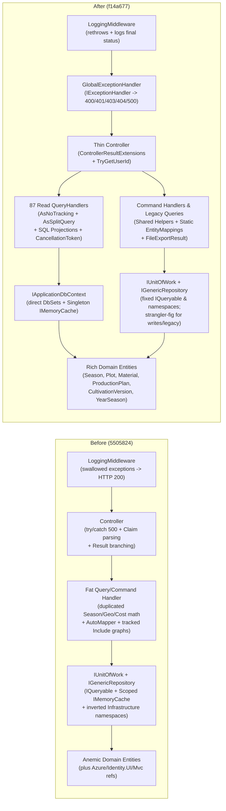

# RiceProduction.API — Architecture Audit & Refactoring Report

**Baseline Commit:** `5505824` (`origin/main` before refactoring)  
**Final Commit:** `f14a677` (`main` after merging `litteFix` and `refactor/priority-1-cleanup`)  
**Total Scope:** `319 files changed, +16,173 insertions / -19,436 deletions` (net `-3,263` lines overall, including `+2,240+` lines of new unit tests & test fixtures — roughly **`5,500+` net lines of duplicated/dead production code eliminated**)

---

## 1. Executive Summary & Verification Metrics

| Metric | Before (`5505824`) | After (`f14a677`) | Delta |
|---|---:|---:|---:|
| Build Errors (`dotnet build`) | 0 | **0** | Maintained |
| NuGet Security / Compat / Duplicate Warnings (`NU*`) | 9 (`NU1504`, 4x `NU1701`, `NU1902`, 3x `NU1903`) | **0** | **-100%** |
| Total Solution Compiler Warnings (`--no-incremental`) | 1,326 | **293** | **-1,033 (-78%)** |
| High-Signal Bug Warnings (`CA2017`, `CS8073`, `CS0472`, `CS1998`, `CS0168`, `CS0108`, `ASP0019`) | 24 | **0** | **-100%** |
| Unit Tests Passing | 143 / 175 (32 failing) | **379 / 379 (0 failing)** | **+236 passing (100% green)** |
| Read-Only QueryHandlers Using Direct `IApplicationDbContext` | 0 | **87** | **+87** |
| `IActionResult` / `Microsoft.AspNetCore.Mvc` Leaks in `Application` & `Domain` | 26 files | **0** | **-100%** |
| Inverted `RiceProduction.Infrastructure.Repository` Refs in `Application` & `Tests` | 22 files | **0** | **-100%** |
| 100% Commented-Out Dead `.cs` Files Removed | 12 files (~1,100+ lines) | **0** | **-100%** |

### Commit History
| Commit | Summary |
|---|---|
| `3e42ebf` | `refactor: simplify handlers, controllers, and repositories` |
| `41776ae` | `chore: merge litteFix into main` |
| `94f2ff4` | `refactor: harden DI, global exception handling, and read queries` |
| `90e2890` | `test: fix all failing unit tests and add helper test suites` |
| `b1aab84` | `refactor: enrich domain entities, replace AutoMapper, and clean packages` |
| `debcb41` | `refactor: introduce IApplicationDbContext and migrate read query handlers` |
| `a6cb4b5` | `refactor: fix compiler bug warnings and migrate remaining read queries` |
| `f14a677` | `chore: merge refactor/priority-1-cleanup into main` |

---

## 2. Detailed Observations, Proof, and Solutions

### 2.1 Critical Runtime Bug: `IMemoryCache` Registered as `Scoped`
- **Observation**: In-memory caching across HTTP requests (`CachingBehavior` and `DecoratorGenericRepository`) could never produce cross-request cache hits because `IMemoryCache` was registered with a `Scoped` lifetime.
- **Proof**:
  - `RiceProduction.Infrastructure/DependencyInjection.cs` (line 116 before `94f2ff4`):
    ```csharp
    builder.Services.AddScoped<IMemoryCache, MemoryCache>();
    ```
  - A `Scoped` `MemoryCache` allocates a fresh cache per HTTP request and disposes it when the request completes, defeating both `CachingBehavior<TRequest, TResponse>` and `DecoratorGenericRepository<T>`.
- **Changes Made (`94f2ff4`)**:
  - Replaced `AddScoped<IMemoryCache, MemoryCache>()` with `builder.Services.AddMemoryCache();` (Singleton) in `RiceProduction.Infrastructure/DependencyInjection.cs`.
  - Also fixed the leftover template namespace `namespace YourApp.Application.Common.Behaviors;` in `RiceProduction.Application/Common/Behaviours/CachingBehavior.cs` → `RiceProduction.Application.Common.Behaviours`.

---

### 2.2 Security & DI Hygiene: Hardcoded SMS Keys and Duplicate/Misplaced Registrations
- **Observation**: Live third-party SMS API keys were hardcoded directly inside C# DI registration code, MVC controller JSON configuration lived inside the Infrastructure layer, and multiple services were registered twice.
- **Proof**:
  - `RiceProduction.Infrastructure/DependencyInjection.cs` (before `94f2ff4`):
    - Line 125–126: hardcoded `new InfobipSmsAPI("21767813b128...", "https://2m6wzp.api.infobip.com")` and commented-out `SpeedSMSAPI` key on line 124.
    - Lines 41–45: `builder.Services.AddControllers().AddJsonOptions(...)` configured MVC inside `RiceProduction.Infrastructure`.
    - Duplicate registrations: `IGenericExcel` (lines 39 & 107), `ApplicationDbContextInitialiser` (lines 58 & 94), and `AddAutoMapper` called in both `Application` (`Assembly.GetEntryAssembly()`) and `Infrastructure` (`typeof(FarmerMapping).Assembly`).
- **Changes Made (`94f2ff4`, `b1aab84`)**:
  - Wired `InfobipSmsAPI` through `IConfiguration` (`Infobip:ApiKey`, `Infobip:BasePath`, `Infobip:DefaultSender`) and removed hardcoded keys from C# source.
  - Moved `.AddJsonOptions(options => options.JsonSerializerOptions.Converters.Add(new JsonStringEnumConverter()))` to `RiceProduction.API/Program.cs`.
  - Removed all duplicate DI registrations and dead commented-out blocks in `Infrastructure/DependencyInjection.cs` and `Program.cs`.
  - Added `RiceProduction.API/appsettings.Example.json` with `"CHANGE_ME"` placeholders for every external secret (`Infobip`, `Zalo`, `AzureStorage`, `GeminiAI`, `Email`, `OpenTelemetry`, `JwtSettings`).

---

### 2.3 Silent Exception Swallowing in `LoggingMiddleware` & Missing Global Exception Handler
- **Observation**: The API had an empty `ExceptionHandler` class, no `UseExceptionHandler()` middleware, and a `LoggingMiddleware` that swallowed unhandled exceptions without rethrowing or setting an error status code — forcing controllers to copy-paste ~100 defensive `try/catch (Exception ex) { return StatusCode(500, ...); }` blocks.
- **Proof**:
  - `RiceProduction.API/Middlewares/ExceptionHandler.cs` (before `94f2ff4`): literally a 6-line empty class `public class ExceptionHandler { }`.
  - `RiceProduction.API/Middlewares/LoggingMiddleware.cs` (lines 43–48 before `94f2ff4`):
    ```csharp
    catch (Exception ex)
    {
        caughtException = ex;
        // ← We catch it, log it, but DO NOT re-throw
        // ASP.NET will still set 500 and your exception filters/problem details still work
    }
    ```
    In ASP.NET Core, swallowing an exception in middleware without rethrowing or setting `StatusCode` causes Kestrel to return **HTTP 200 OK with an empty body**.
  - `Select-String 'catch\s*\(Exception'` across `RiceProduction.API/Controllers/` found **116 `catch (Exception)` blocks across 24 controllers** duplicating 500 error logging and response construction.
- **Changes Made (`94f2ff4`)**:
  - Implemented `GlobalExceptionHandler : IExceptionHandler` in `RiceProduction.API/Middlewares/ExceptionHandler.cs`, mapping:
    - `ValidationException` → `400 Bad Request`
    - `UnauthorizedAccessException` → `401 Unauthorized`
    - `ForbiddenAccessException` → `403 Forbidden`
    - `KeyNotFoundException` → `404 Not Found`
    - `ArgumentException` / `InvalidOperationException` → `400 Bad Request`
    - Unhandled `Exception` → `500 Internal Server Error`
    All returning uniform `Result<object>` JSON payloads.
  - Fixed `LoggingMiddleware` to `throw;` after recording `caughtException` and placed `app.UseExceptionHandler();` inside `app.UseMiddleware<LoggingMiddleware>();` in `Program.cs` so `LoggingMiddleware` logs the accurate final HTTP status code.
  - Stripped ~100 redundant `try/catch (Exception ex)` → 500 blocks across 22 controllers and centralized `Result`/`PagedResult` HTTP mapping in `RiceProduction.API/Common/ControllerResultExtensions.cs` (`ToActionResult`, `ToIActionResult`, `ToNotFoundOrBadRequest`, `ToFileActionResult`) and claim parsing in `ClaimsPrincipalExtensions.cs` (`TryGetUserId`).

---

### 2.4 Massive Cross-File Duplication & Dead Code
- **Observation**: Identical domain calculations, geometry utilities, Excel import pipelines, repository `.Include(...)` chains, and controller claim/result boilerplate were copy-pasted across dozens of files, alongside 12 completely commented-out dead files.
- **Proof (exact file counts before refactoring)**:
  - `IsDateInSeasonRange` / `"MM/DD"` season date parsing duplicated in **16 files**.
  - `CalculateAreaInHectares` duplicated in **5 files**.
  - `CreateDefaultBoundary` duplicated in **4 files**.
  - `SerializeGeometry` (GeoJSON) duplicated in **2+ files**.
  - `ImportPlotByExcelCommandHandler.cs` (763 lines) and `ImportPlotsFromDataCommandHandler.cs` (720 lines) were **~85% carbon copies** of the same import pipeline.
  - Material price lookup, package rounding, and cost aggregation duplicated across **5 Material/StandardPlan cost handlers**.
  - `ClaimTypes.NameIdentifier` + `Guid.TryParse` duplicated across **14+ controller actions**.
  - **12 files** were 100% commented out (e.g., `SmsController.cs` 110 lines, `SmsRetryService.cs` 253 lines, `SmsRetryBackgroundService.cs` 105 lines, `GeminiAIService.cs` 230 lines, `GetPendingDistributionsForSupervisorQueryHandler.cs` 146 lines, `GetAIRecommendationsQueryHandler.cs` 101 lines, `IApplicationDbContext.cs`, and 5 dead `SmsFeature` files).
  - Repositories (`SupervisorRepository`, `ClusterManagerRepository`, `UavVendorRepository`, `AgronomyExpertRepository`, `LateFarmerRecordRepository`, `ClusterRepository`, `FarmerRepository`, `PlotRepository`) each repeated identical `.Include(...).ThenInclude(...)` chains 4–10 times per class.
- **Changes Made (`3e42ebf`)**:
  - Deleted all 12 completely commented-out dead `.cs` files.
  - Consolidated cross-file logic into focused helpers:
    - `RiceProduction.Application/Common/Helpers/SeasonDateHelper.cs` (eliminated 15 of 16 duplicates; only seed script left)
    - `RiceProduction.Application/Common/Helpers/PlotGeometryHelper.cs` (eliminated all 9 duplicates)
    - `RiceProduction.Application/Common/Helpers/PlotImportHelper.cs` (reduced `ImportPlotByExcelCommandHandler` from **697 → 58 lines** and `ImportPlotsFromDataCommandHandler` from **659 → 52 lines**)
    - `RiceProduction.Application/Common/Helpers/MaterialCostHelper.cs` (consolidated across all 5 cost handlers)
    - `RiceProduction.API/Common/ClaimsPrincipalExtensions.cs` & `ControllerResultExtensions.cs`
  - Extracted `QueryWithDetails()`, `ApplySearchFilters()`, and `ApplyOrderingAndPaging()` across all 9 repositories and replaced `Activator.CreateInstance` reflection in `UnitOfWork.cs` with direct generic instantiation + `??=` properties.
  - Simplified 125+ largest handlers, controllers, and infrastructure services (`GroupFormationService`, `ViewGroupBySeasonQueryHandler`, `ResolveReportCommandHandler`, `ResolveEmergencyPlanCommandHandler`, `ContextualGeminiAIService`, `EmailService`, `IdentityService`, `GenericExcel`, `FarmerExcelImplement`, `DecoratorGenericRepository`, etc.).

---

### 2.5 Clean Architecture Layer Boundary Violations
- **Observation**: Inner layers depended on outer-layer types and namespaces in three ways:
  1. `RiceProduction.Application` returned ASP.NET Core MVC `IActionResult` from `IGenericExcel` and 12 Excel download queries/handlers (24 files), and `GenericExcel` leaked undisposed `MemoryStream` instances into `FileStreamResult`.
  2. `RiceProduction.Domain.csproj` referenced infrastructure packages (`Azure.Identity`, `Microsoft.AspNetCore.Identity.UI`, `Microsoft.AspNetCore.Diagnostics.EntityFrameworkCore`, `Microsoft.EntityFrameworkCore.Tools`), hiding a stray `using Microsoft.AspNetCore.Mvc;` in `FarmLog.cs` and `using Azure.Core;` in `ImportFarmerCommand.cs`.
  3. Four interfaces inside `RiceProduction.Application/Common/Interfaces/` (`IAgronomyExpertRepository`, `IClusterManagerRepository`, `ISupervisorRepository`, `IUavVendorRepository`) were declared in `namespace RiceProduction.Infrastructure.Repository`, forcing `Application` and `Tests` to import an Infrastructure namespace in 22 files.
  4. `ProductionPlanApprovalEventHandler` was declared in the global namespace (no `namespace` declaration).
- **Proof**:
  - `Select-String 'IActionResult'` matched `IGenericExcel.cs` + 24 Query/Handler files in `RiceProduction.Application`.
  - `Select-String '^namespace '` on `RiceProduction.Application/Common/Interfaces/*.cs` showed 4 files in `RiceProduction.Infrastructure.Repository`.
  - Removing `Identity.UI` and `Azure.Identity` from `RiceProduction.Domain.csproj` immediately surfaced compile errors on unused `using Microsoft.AspNetCore.Mvc;` (`FarmLog.cs:1`) and `using Azure.Core;` (`ImportFarmerCommand.cs:6`).
- **Changes Made (`94f2ff4`, `b1aab84`, `debcb41`)**:
  - Updated `IGenericExcel` and `GenericExcel` to return `Task<FileExportResult?>` using `using var memoryStream = new MemoryStream()` (`ToArray()`), migrated all 12 Query/Handler pairs to `Result<FileExportResult>`, and updated all 5 calling controllers to use `this.ToFileActionResult(result)`.
  - Stripped unused infrastructure packages from `RiceProduction.Domain.csproj`, removed stray `Mvc` / `Azure` usings from `Domain` and `Application`, and added explicit `<FrameworkReference Include="Microsoft.AspNetCore.App" />` to `Application.csproj` for `IFormFile`/`IHttpContextAccessor`.
  - Moved the 4 repository interfaces into `namespace RiceProduction.Application.Common.Interfaces` and removed all 18 inverted `using RiceProduction.Infrastructure.Repository;` directives in `Application` and `Tests`.
  - Placed `ProductionPlanApprovalEventHandler` in `namespace RiceProduction.Application.CultivationFeature.Event;`.

---

### 2.6 Leaky Repository Abstraction, Tracking Overhead & `IQueryable<T?>` Nullability Bug
- **Observation**:
  1. `IGenericRepository<T>.GetQueryable()` was typed as `IQueryable<T?>` (nullable `T?`), causing **~900+ `CS8602`/`CS8622`/`CS8634` warnings** across the Application layer.
  2. `DecoratorGenericRepository<T>.GetQueryable()` threw `NotImplementedException()`.
  3. `IUnitOfWork.ClusterRepository` and `IUnitOfWork.UavVendorRepository` were marked nullable (`?`) even though `UnitOfWork` always initialized them non-null.
  4. Read-only query handlers loaded entire tracked `.Include(...).ThenInclude(...)` graphs (including large PostGIS `Polygon` geometries) with EF change tracking enabled, no `.AsSplitQuery()` on multi-collection joins (causing SQL Cartesian explosion), in-memory pagination after `ToListAsync()`, and missing `CancellationToken` propagation.
- **Proof**:
  - `IGenericRepository.cs:47` (before `94f2ff4`): `IQueryable<T?> GetQueryable();`.
  - `DecoratorGenericRepository.cs:110`: `public IQueryable<T?> GetQueryable() => throw new NotImplementedException();`.
  - `Select-String` found **42 read-only `*QueryHandler`s** calling `GetQueryable()` without `.AsNoTracking()`.
  - Fixing `IQueryable<T?>` → `IQueryable<T>` alone dropped compiler warnings from **1,291 → 346 (-945 warnings)**.
- **Changes Made (`94f2ff4`, `debcb41`, `a6cb4b5`)**:
  - Fixed `IGenericRepository<T>.GetQueryable()` to return `IQueryable<T>`, delegated `DecoratorGenericRepository.GetQueryable()` to `_repository.GetQueryable()`, and made `IUnitOfWork.ClusterRepository` / `UavVendorRepository` non-nullable.
  - Created `IApplicationDbContext` (`RiceProduction.Application/Common/Interfaces/IApplicationDbContext.cs`) exposing all entity `DbSet<T>`s (including previously missing `PlotPolygonTasks` and `LateFarmerRecords`), implemented it on `ApplicationDbContext`, and registered it in DI.
  - Migrated **87 read-only QueryHandlers** directly onto `IApplicationDbContext` with:
    - `.AsNoTracking()` on every read query
    - `.AsSplitQuery()` on multi-collection `.Include(...)` queries
    - Direct SQL `.Select(...)` / `.CountAsync(...)` / `.SumAsync(...)` projections skipping PostGIS geometries on dashboard and list endpoints (`GetYearSeasonDashboard`, `GetYearSeasonDetail`, `GetYearSeasonReadiness`, `GetYearSeasonsByCluster`, `GetActiveYearSeasons`, `GetPolygonAssignmentTasks`, `GetClusterAvailableSeasons`, `GetClusterHistory`, `ViewGroupBySeason`)
    - Server-side `CountAsync` + `Skip`/`Take` pagination (`GetApprovedPlans`, `GetPendingApprovals`, `GetAllPestProtocols`, `GetAllWeatherProtocols`, `GetFarmLogs*`, `GetGroupsByManager`, `GetClusterServiceOrdersByManager`, `GetVendorServiceOrders`, `GetAllMaterialByType`)
    - Batched lookups eliminating N+1 queries (`PreviewPlotImport`, `PreviewGroups`, `GetMyGroupHistory`)
    - Full `CancellationToken` propagation to all EF async calls
  - Added `TestApplicationDbContext` (EF Core InMemory fixture) + `YearSeasonDbContextQueryHandlerTests` demonstrating zero-Moq end-to-end handler tests.

---

### 2.7 Anemic Domain Model → Rich Domain Entities
- **Observation**: Domain entities were plain property bags while core business invariants (season date-range resolution, plot polygon area tolerance & boundary assignment, material partition packaging, cultivation version switching, production plan approval transitions, year-season windows) lived scattered across handlers.
- **Proof**: Every entity in `RiceProduction.Domain/Entities/` had zero behavior methods, causing `IsDateInSeasonRange` (16 copies), `CalculateAreaInHectares` (5 copies), and manual `CultivationVersion` activation/deactivation loops to drift across handlers.
- **Changes Made (`b1aab84`)**:
  - Enriched 6 core Domain entities with zero database schema/migration impact:
    - `Season`: `TryParseMonthDay`, `IsDateInRange`, `ContainsDate`, `TryGetDateRange`, `ResolveYearForDate`
    - `Plot`: `HasValidBoundary`, `CalculatePolygonAreaInHectares`, `IsBoundaryWithinTolerance`, `AssignBoundary`, `MarkPendingPolygon`
    - `Material`: `EffectiveAmountPerMaterial`, `CalculatePackagesNeeded`, `CalculateTotalCost`
    - `CultivationVersion`: `Deactivate`, `Activate`, `CreateNext`
    - `ProductionPlan`: `CanBeReviewed`, `IsApproved`, `Submit`, `Approve`, `Reject`
    - `YearSeason`: `IsSelectionWindowOpen`, `IsPlanningWindowOpen`, `IsDateWithinSeason`
  - Delegated `SeasonDateHelper`, `PlotGeometryHelper`, `MaterialCostHelper`, and relevant command/query/event handlers to these domain methods as the single source of truth.
  - Added **121 unit tests** in `RiceProduction.Tests/Unit/Domain/DomainEntitiesTests.cs`.

---

### 2.8 Package Vulnerabilities (`NU1902`, `NU1903`), Legacy `.NET Framework` Packages (`NU1701`) & AutoMapper Removal
- **Observation**: Every build emitted 9 NuGet warnings, including 3 high-severity CVEs, 1 moderate CVE, 4 `.NET Framework 4.x` compatibility warnings, and 1 duplicate package reference.
- **Proof (baseline `dotnet build` output)**:
  - `NU1504`: Duplicate `OpenTelemetry.Exporter.Prometheus.AspNetCore` (`1.9.0-beta.2` and `1.7.0-beta.1`) in `RiceProduction.API.csproj`.
  - `NU1701` (x4): `vng.zalo.ZaloDotNetSDK 2.1.2` + transitive `Microsoft.AspNet.WebApi.Client 5.2.3` targeting `.NETFramework 4.6.1–4.8.1` — `Select-String` proved `ZaloDotNetSDK` had **0 usages** in code (`ZaloZnsService` uses `HttpClient`).
  - `NU1902`: `OpenTelemetry.Exporter.OpenTelemetryProtocol 1.9.0` (`GHSA-4625-4j76-fww9`) — **0 usages** in `Program.cs` (the app uses Prometheus scraping).
  - `NU1903` (x3): `AutoMapper 13.0.1` (`GHSA-6vhm-j9h7-f9gh`, `GHSA-gpwp-5797-mjff`, `GHSA-rvv3-g6hj-g44x`, patched only in commercial v15+) — `Select-String '_mapper\.'` proved AutoMapper was only called in **13 lines across the entire 945-file codebase** (while 4 other handlers injected `IMapper` without using it).
- **Changes Made (`94f2ff4`, `b1aab84`)**:
  - Removed duplicate `OpenTelemetry.Exporter.Prometheus.AspNetCore 1.7.0-beta.1` (`NU1504`).
  - Removed unused `vng.zalo.ZaloDotNetSDK` (`NU1701` x4).
  - Removed unused `OpenTelemetry.Exporter.OpenTelemetryProtocol` (`NU1902`) and upgraded remaining `OpenTelemetry` packages to `1.11.x`.
  - Replaced all 13 `_mapper.Map<...>()` calls with compile-time-safe `EntityMappings.cs` extension methods, deleted 11 AutoMapper `Profile` classes, removed 4 unused `IMapper` injections, and uninstalled `AutoMapper` (`NU1903` x3).
  - **Result**: **0 NuGet warnings across the entire solution.**

---

### 2.9 Unit Test Suite Recovery & 3 Real Production Bugs Caught
- **Observation**: The baseline unit test suite had **32 failing tests out of 175** (81.7% pass rate), masking real runtime defects.
- **Proof & Production Bugs Uncovered**:
  1. **Runtime `FormatException` in `CreatePestProtocolCommandHandler.cs:87`**: Logger template had a stray closing brace `"Unexpected error while creating pest protocol '{ProtocolName}'}"`, crashing `Handle_DatabaseError_ReturnsFailure` with `System.FormatException`.
  2. **Broken Quantity Aggregation in `MaterialCostHelper.AggregateMaterialCost`**: `CalculateMaterialsCostByAreaQueryHandlerTests.Handle_GroupedMaterialsSameMaterialId_SumsQuantities` failed (`Expected 60M, found 30M`) because `AggregateMaterialCost` summed `TotalQuantityNeeded`, `PackagesNeeded`, `ActualQuantity`, and `TotalCost` but omitted `existing.QuantityPerHa += materialCost.QuantityPerHa;`.
  3. **Missing Area Validation in `CreatePlotsCommandHandler.cs`**: When invoked outside MVC model binding, the handler did not check `!plot.Area.HasValue || plot.Area.Value <= 0`, allowing zero/negative areas or null-dereference on `plotRequest.Area!.Value`.
  4. **Stale Test Mocks**: 29 other failures were caused by missing Moq setups (`Season`, `Farmer`, `RiceVariety`, `YearSeason`, `CultivationVersion`, `Cluster` repositories returning `null`), missing `Id = Guid.NewGuid()` callbacks on mocked `AddAsync`/`CreateAsync`, and outdated assertions expecting raw exception messages instead of safe handler error strings.
- **Changes Made (`94f2ff4`, `90e2890`, `b1aab84`, `debcb41`)**:
  - Fixed all 3 production bugs.
  - Updated stale mock setups and assertions across all 13 failing test files so every test verifies real handler behavior.
  - Added **204 new unit tests** across 5 new test files:
    - `SeasonDateHelperTests.cs`, `PlotGeometryHelperTests.cs`, `MaterialCostHelperTests.cs` (80 tests)
    - `DomainEntitiesTests.cs` (121 tests)
    - `YearSeasonDbContextQueryHandlerTests.cs` (3 InMemory EF Core tests)
  - **Result**: **379 / 379 tests passing (100% green) in ~1 second.**

---

### 2.10 High-Signal Static Analysis & Compiler Bug Warnings
- **Observation**: Even after fixing `IQueryable<T?>`, `--no-incremental` surfaced 18 concrete code-quality/bug warnings across the solution.
- **Proof & Fixes (`94f2ff4`, `a6cb4b5`)**:
  - `CA2017` (`ChangeFarmerStatusCommandHandler.cs:54`): Mismatched `{Reason}` log template placeholder removed.
  - `CS8073` (`GetGroupsByClusterManagerIdQueryHandler.cs:33`, `GetAllSupervisorQueryHandler.cs:33`): Always-false `Guid == null` checks fixed to check `!_currentUser.Id.HasValue || _currentUser.Id.Value == Guid.Empty`.
  - `CS0472` (`ValidateCultivationPreferencesQueryHandler.cs:130`): Always-true `plot.Area != null` check removed on non-nullable `decimal`.
  - `CS0108` (`FarmerDetailDTO.cs:34`): Removed redundant hiding `ProductionStageDetailDTO.ProductionPlanTasks` property.
  - `ASP0019` (`ClusterController.cs`): Switched `Response.Headers.Add(...)` to `Response.Headers.Append(...)` (prevents duplicate-header `ArgumentException`).
  - `CS0168` (2 files) & `CS1998` (8 methods across `Application`, `Infrastructure`, `API`, `Tests`): Removed unused `ex` catch variables and unnecessary `async` state machines.

---

## 3. Architecture Before vs. After



---

## 4. Recommended Follow-Up Items

1. **Rotate Credentials Currently Tracked in `appsettings.json`**: `appsettings.json` still contains historical keys (Azure Storage, Zalo, Grafana OTLP, Email, JWT secret) and git history contains the old Infobip key. Rotate those credentials and load production values from environment variables / Azure Key Vault using `appsettings.Example.json` as the template.
2. **Incremental `IApplicationDbContext` Adoption**: New command/query handlers should inject `IApplicationDbContext` directly (with `TestApplicationDbContext` for fast InMemory tests), migrating remaining legacy `IUnitOfWork` command handlers opportunistically as features change.
3. **PostGIS Integration Tests**: Complement the 379 fast unit/InMemory tests with a small Testcontainers (`postgis/postgis`) integration test suite covering PostGIS spatial queries (`PostGISGroupFormationService`, polygon validation/intersection).
4. **Remaining 293 Nullable Warnings (`CS8602`/`CS8618`)**: Almost all remaining compiler warnings are nullable annotations on legacy DTOs/entities and `ApplicationDbContextInitialiser.cs` seed data; they can be cleaned up incrementally per feature.
