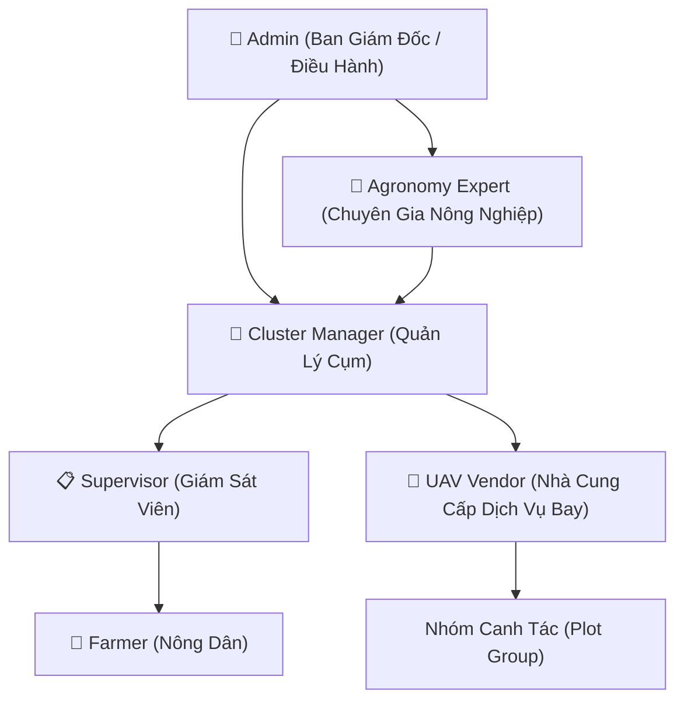
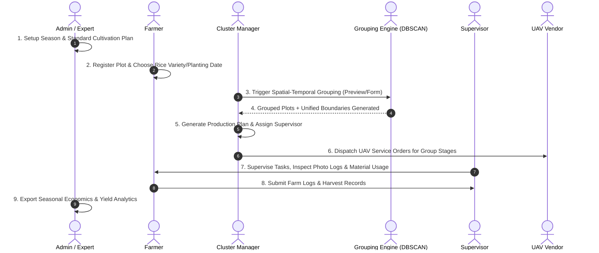

# Smart Rice Production Workflow Management System (SRPW)
**Enterprise Agricultural Workflow, Spatial Optimization & Lifecycle Management Platform**

---

## 1. Executive Summary

The **Smart Rice Production Workflow Management System (SRPW)** is an enterprise agricultural platform developed in collaboration between **FPT University** and **Duc Thanh Company** (a leading agricultural inputs and farming enterprise in Vietnam). 

The platform digitizes, standardizes, and automates the entire end-to-end rice cultivation lifecycle across large-scale farming clusters (*Cụm Nông Nghiệp*). By bridging the gap between agribusiness leadership, agronomy experts, field supervisors, UAV (drone) service vendors, and individual smallholder farmers, SRPW eliminates manual coordination bottlenecks, optimizes material supply chains, and synchronizes drone-based agricultural services.

---

## 2. Core Business Problems Solved

Before this system was implemented, agricultural operations faced significant inefficiencies:

| Traditional Challenge | SRPW Solution |
|---|---|
| **Fragmented Sowing Schedules**<br>Farmers planted independently, making mass crop care, water management, and synchronous spraying impossible. | **Spatial-Temporal Plot Grouping (DBSCAN)**<br>Automatically groups adjacent farmlands planting the same rice variety within tight date windows ($\pm 2$ days) into unified operational units. |
| **Inefficient Drone (UAV) Dispatching**<br>UAV sprayers had to fly between isolated, scattered plots, drastically inflating operational costs. | **Synchronized UAV Service Orders**<br>Aggregates flight missions across contiguous plot groups, maximizing drone flight efficiency and chemical distribution accuracy. |
| **Unstandardized Farming & Paper Logs**<br>Farming activities were recorded on paper or word-of-mouth, leading to delayed pest responses and untracked chemical usage. | **Digital Farm Logs & Multi-Role Task Tracking**<br>Standardized cultivation schedules with real-time digital logging, photo verification, and material usage audits. |
| **Reactive Pest & Weather Responses**<br>Pest outbreaks or severe weather events were handled reactively without standard scientific guidance. | **Emergency Protocols & Early Alerts**<br>Pre-configured agronomy protocols triggered automatically with multi-channel alerts (SMS, Zalo ZNS, Push). |
| **Material Leakage & Cost Opacity**<br>Inaccurate estimations of seed, fertilizer, and pesticide needs across thousands of hectares. | **Automated Material Distribution & Economic Analytics**<br>Exact material quotas calculated per plot area and aggregated for seasonal economics reporting. |

---

## 3. System Architecture & Tech Stack

The solution is architected following **Clean Architecture (Onion Architecture)** and the **CQRS (Command Query Responsibility Segregation)** pattern.

```
┌────────────────────────────────────────────────────────┐
│               RiceProduction.API (REST)                │
│    Controllers, Middlewares, Auth (JWT), OpenTelemetry │
└───────────────────────────┬────────────────────────────┘
                            │
┌───────────────────────────▼────────────────────────────┐
│              RiceProduction.Application                │
│   Commands/Queries (MediatR), Validations, Services,   │
│   DBSCAN Clustering Engine, DTOs, Event Handlers       │
└───────────────────────────┬────────────────────────────┘
                            │
┌───────────────────────────▼────────────────────────────┐
│              RiceProduction.Infrastructure             │
│   EF Core, PostgreSQL / PostGIS, NetTopologySuite,     │
│   Repositories, Unit of Work, Infobip SMS, Zalo, Email │
└───────────────────────────┬────────────────────────────┘
                            │
┌───────────────────────────▼────────────────────────────┐
│                RiceProduction.Domain                   │
│   Entities, Enums, Value Objects, Domain Events        │
└────────────────────────────────────────────────────────┘
```

### Technology Highlights
* **Core Framework:** .NET 9 / C# 13, ASP.NET Core Web API
* **Architecture Pattern:** Clean Architecture, CQRS with **MediatR**, Repository & Unit of Work pattern
* **Database & Spatial Engine:** **PostgreSQL 16** with **PostGIS** extension
* **Geospatial Processing:** **NetTopologySuite (NTS)** (Polygon operations, Centroids, Haversine distance, Spatial Indexing with STRtree)
* **Authentication & Authorization:** JWT (JSON Web Tokens) with custom role-based claims & refresh tokens
* **Notifications & Integrations:** Zalo Cloud (ZNS), Infobip SMS API, SendGrid/SMTP Email Batches
* **Observability & Logging:** Serilog, OpenTelemetry, Grafana Loki, Custom Request/Response Logging Middlewares
* **DevOps:** Docker containerization, Multi-stage Dockerfile, GitHub Actions CI/CD

---

## 4. Key User Roles & Stakeholders



### 1. Enterprise Administrator (`Admin`)
* Manages company-wide clusters, master data (seasons, rice varieties, categories).
* Sets system-wide parameters (clustering thresholds, material price indexes).
* Views macro-level analytics, operational reports, and seasonal financials.

### 2. Agronomy Expert (`AgronomyExpert`)
* Designs **Standard Cultivation Plans** (*Kế hoạch canh tác chuẩn*) specifying stages (Soil prep, Sowing, Tillering, Heading, Ripening, Harvesting), tasks, and precise material dosage formulas.
* Configures **Pest & Weather Emergency Protocols** with predefined response action plans and chemical treatments.
* Evaluates seasonal economic efficiency and yield estimates.

### 3. Cluster Manager (`ClusterManager`)
* Oversees assigned regional farming clusters (*Cụm*).
* Executes the **Automated Plot Grouping Engine** (DBSCAN spatial clustering).
* Generates and approves group-level **Production Plans**.
* Creates and manages bulk **UAV Service Orders** for grouped plots.

### 4. Field Supervisor (`Supervisor`)
* Maps and assigns farmer land parcel boundaries (*Plot Polygon Boundaries*).
* Monitors daily farming progress and verifies **Farmer Logs (Farmlog)** and photo evidence.
* Records delayed/late farming activities (`LateFarmerRecord`) and resolves operational alerts.

### 5. Farmer (`Farmer`)
* Registers land parcels (`Plot`) with cadastral details (*Số Thửa, Số Tờ*).
* Selects rice varieties and declares expected planting schedules for upcoming seasons.
* Receives daily/weekly task notifications via Mobile App, SMS, and Zalo.
* Submits completed task logs, photo evidence, and material consumption.

### 6. UAV Service Vendor (`UAVVendor`)
* Receives grouped flight requests with aggregated polygon boundaries and chemical payloads.
* Executes synchronized aerial spraying/fertilizing across contiguous plots.
* Submits post-flight reports and billing invoices.

---

## 5. End-to-End Operational Lifecycle



---

## 6. Highlight: Spatial-Temporal Grouping Algorithm (DBSCAN)

The hallmark engineering innovation in this platform is the automated clustering engine that merges fragmented smallholder plots into cohesive operational farming groups.

### Clustering Constraints & Pipeline:
1. **Hard Constraint Partitioning:** Partitions all candidate plots strictly by `RiceVarietyId` (different varieties cannot share the same operational schedule).
2. **Spatial Density Clustering (DBSCAN):**
   * Uses **NetTopologySuite STRtree** spatial index or PostgreSQL **PostGIS `ST_ClusterDBSCAN`**.
   * Identifies spatial clusters based on a proximity threshold $\epsilon$ ($100\text{m} - 2000\text{m}$) and minimum density ($\ge 3 - 5\text{ plots}$).
3. **Spatial Coherence Validation:** Calculates the maximum pairwise cluster diameter ($\le 2 \times \epsilon$). If a cluster is stretched into a narrow snake-like formation, it is automatically split using `SplitByDiameter`.
4. **Temporal Window Clustering:** Groups plots within a configurable `PlantingDateTolerance` ($\pm 2\text{ days}$) and computes the `MedianPlantingDate`.
5. **Capacity Control & Greedy Slicing:** Enforces minimum/maximum area limits ($5\text{ ha} - 50\text{ ha}$) and plot count limits ($3 - 10\text{ plots}$). Large clusters are smoothly partitioned using a boundary seed-and-grow nearest-neighbor algorithm.
6. **Boundary Union & Smoothing:** Combines individual plot polygons into a single group boundary (`ST_Union` + `ST_Buffer`), producing a flight polygon for UAV drones.

---

## 7. Key System Modules

```
RiceProduction.API/
├── Controllers/
│   ├── ClusterController.cs             # Regional clusters & season management
│   ├── CultivationPlanController.cs     # Plot-level customized cultivation plans
│   ├── EmergencyProtocolController.cs   # Emergency outbreak mitigation workflows
│   ├── FarmlogController.cs             # Farmer daily task submissions & photo proof
│   ├── GroupController.cs               # Spatial DBSCAN grouping & manual exceptions
│   ├── MaterialDistributionController.cs# Seed/Fertilizer/Pesticide distribution
│   ├── MetricsController.cs             # Real-time operational metrics & KPI dashboard
│   ├── PestProtocolController.cs        # Scientific disease & pest treatment guides
│   ├── PlotController.cs                # Geospatial plots, Excel batch import/export
│   ├── ProductionPlanController.cs      # Group-level master cultivation schedules
│   ├── StandardPlanController.cs        # Agronomy blueprint templates
│   ├── UavController.cs                 # UAV flight orders, scheduling & invoicing
│   ├── WeatherProtocolController.cs     # Weather anomaly response workflows
│   └── ZaloController.cs / SmsController# Multi-channel notification dispatchers
```

---

## 8. Summary of Business Impact

* **Operational Efficiency:** Cut manual group formation and supervisor scheduling from days of manual guesswork to sub-second automated spatial clustering.
* **Drone Cost Optimization:** Contiguous flight paths reduced UAV flight turnarounds and pesticide waste by over 25%.
* **Full Lifecycle Traceability:** Complete digital provenance from seed sowing to harvest, supporting sustainable agriculture standards (SRP - Sustainable Rice Platform).
* **Direct Stakeholder Value:** Successfully pitched and validated with the Board of Directors of Duc Thanh Company, proving the commercial feasibility of digital agriculture in Vietnam.
